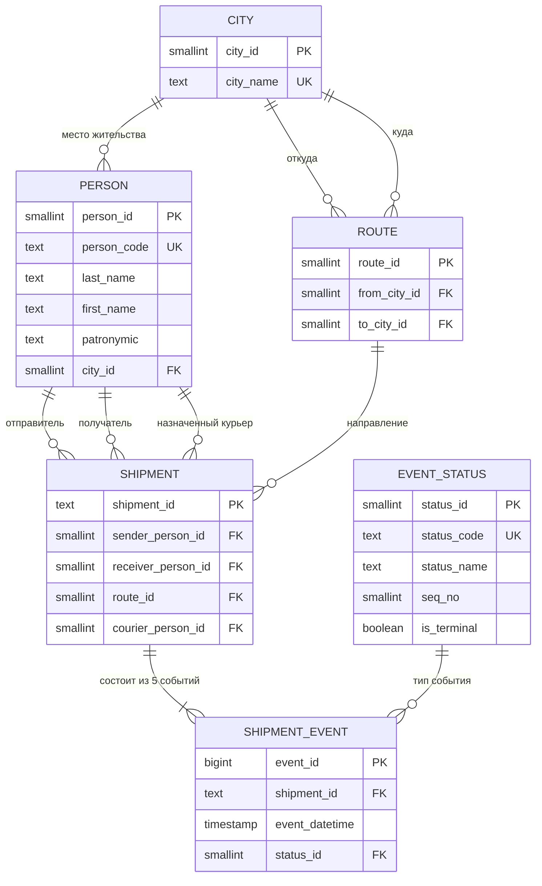

# Этап 2. Бизнес-сущности, ключи, связи и правила очистки

**Команда 06 · «Доставка посылок»** · продолжение отчёта `01_профилирование.md`

Документ фиксирует **целевую логическую модель** хранилища и **правила преобразования**
RAW → `core`. Реализация (DDL, функции `core.step_*`, карантин, витрины) — этапы 3–10.

---

## 1. Принципы моделирования

1. **RAW неприкосновенен.** `public.raw_data_06` — только чтение; любые исправления
   выполняются «на лету» в слое преобразования.
2. **Одна сущность — одна таблица.** Повторяющиеся текстовые значения (город, человек,
   статус, маршрут) выносятся в справочники, а не дублируются в факте.
3. **Суррогатный ключ + естественный ключ.** У каждой таблицы есть технический
   `*_id` и `UNIQUE`-ограничение по бизнес-ключу — это основа идемпотентности.
4. **Ничего не теряем.** Каждая строка RAW получает объяснимый итог:
   `загружена` / `дубликат` / `карантин`.
5. **Минимум хардкода.** Справочники (города, люди, маршруты, курьеры) **строятся из RAW**.
   Жёстко зафиксированы только: перечень допустимых статусов и их порядок
   (это бизнес-правило, а не данные) и перечень городов-«валидаторов».
6. **Детерминизм.** Один и тот же RAW при любом числе запусков даёт один и тот же результат.

---

## 2. Бизнес-сущности

| № | Сущность | Что это в предметной области | Обоснование из профиля | Оценка строк |
| ---: | :--- | :--- | :--- | ---: |
| E1 | **Город** (`city`) | населённый пункт отправления/назначения | 8 значений, всегда канонические | 8 |
| E2 | **Человек** (`person`) | физлицо: отправитель, получатель или курьер | 20 фамилий, коды `S/R/C 1–20` совпадают | 20 |
| E3 | **Маршрут** (`route`) | пара «город отправления → город назначения» | 64 пары = 8 × 8; `route_info` всегда им равен | 64 |
| E4 | **Статус события** (`event_status`) | справочник этапов жизненного цикла | 12 написаний → 6 значений + `???` | 6 (+1) |
| E5 | **Посылка** (`shipment`) | объект доставки: кто, кому, откуда, куда, каким курьером | 2 000 канонических ID; участники и маршрут постоянны внутри посылки | 2 000 |
| E6 | **Событие посылки** (`shipment_event`) | факт смены статуса в момент времени | 10 178 строк RAW; 5 событий на посылку | ~8 780 |
| E7 | **Строка RAW** (`stg_raw_row`, техн.) | неизменяемый слепок исходной записи с устойчивым хешем | у RAW нет PK | 10 178 |
| E8 | **Карантин** (`quarantine_row`, служ.) | очередь записей, которые нельзя преобразовать безопасно | 1 049 + 193 − 22 = 1 220 | 1 220 |

**Почему `курьер` — не отдельная сущность, а роль человека.**
Коды `C1…C20` указывают на те же 20 человек, что `S1…S20` и `R1…R20`
(совпадение фамилии и имени для каждого номера — проверено). Поэтому отдельная
таблица `courier` создала бы дублирование людей. Курьер — это **назначение**
(`shipment.courier_person_id`), а не самостоятельный субъект.

**Почему `маршрут` — отдельная таблица, хотя выводим из городов.**
Пара городов — это устойчивое измерение с 64 значениями, по которому строятся
аналитические срезы («доля направлений», «загрузка коридоров»). Хранить в факте
две ссылки на город можно, но тогда любой срез «по направлению» требует `GROUP BY`
по двум полям и теряет идентичность направления. Отдельный `route` — дешевле и чище.
При этом `route_info` из RAW **не хранится как текст**: он проверяется на согласованность
с городами и отбрасывается (он избыточен — 0 расхождений на 10 178 строках).

---

## 3. ER-диаграмма (логическая)



Текстовое представление связей:

| Связь | Кардинальность | Обязательность | Комментарий |
| :--- | :--- | :--- | :--- |
| `city` → `person` | 1 : N | у человека город обязателен | у каждого человека ровно 1 город, 0 исключений |
| `city` → `route` (from) | 1 : N | обязательна | |
| `city` → `route` (to) | 1 : N | обязательна | |
| `person` → `shipment` (sender) | 1 : N | обязательна | 2 000 посылок, 250 в среднем на город |
| `person` → `shipment` (receiver) | 1 : N | обязательна | |
| `person` → `shipment` (courier) | 1 : N | **необязательна** (NULL) | курьер известен не всегда |
| `route` → `shipment` | 1 : N | обязательна | маршрут выводится из городов участников |
| `shipment` → `shipment_event` | 1 : 5 | обязательна | в норме 5 событий; после чистки — ≤ 5 |
| `event_status` → `shipment_event` | 1 : N | обязательна | |

---

## 4. Словарь данных (атрибуты, типы, ключи, ограничения)

### 4.1 `core.city` — города

| Атрибут | Тип | NULL | Ограничение | Источник / правило |
| :--- | :--- | :--- | :--- | :--- |
| `city_id` | `smallint` | нет | `PK` | суррогат, `row_number()` по алфавиту |
| `city_name` | `text` | нет | `UNIQUE`, `CHECK (city_name <> '')` | `btrim(split_part(sender_info,'/',2))`, нормализованный регистр |

### 4.2 `core.person` — люди

| Атрибут | Тип | NULL | Ограничение | Источник / правило |
| :--- | :--- | :--- | :--- | :--- |
| `person_id` | `smallint` | нет | `PK` | суррогат |
| `person_code` | `text` | да | `UNIQUE` | код `S##/R##/C##` → `P01…P20` |
| `last_name` | `text` | нет | `CHECK (~ '^[А-ЯЁ][а-яё-]+$')` | первый токен ФИО после нормализации |
| `first_name` | `text` | нет | то же | второй токен |
| `patronymic` | `text` | да | — | третий токен, если есть (иначе восстанавливается из других строк) |
| `city_id` | `smallint` | нет | `FK → city` | город из любой строки этого человека |

`UNIQUE (last_name, first_name)` — естественный ключ; в данных фамилии уникальны,
поэтому дополнительно `UNIQUE (last_name)` не требуется, но проверяется.

### 4.3 `core.route` — направления

| Атрибут | Тип | NULL | Ограничение | Источник |
| :--- | :--- | :--- | :--- | :--- |
| `route_id` | `smallint` | нет | `PK` | суррогат |
| `from_city_id` | `smallint` | нет | `FK → city` | город отправителя |
| `to_city_id` | `smallint` | нет | `FK → city` | город получателя |

`UNIQUE (from_city_id, to_city_id)` — естественный ключ (64 строки).
`CHECK (from_city_id <> to_city_id)` **не ставить**: 270 посылок идут «город → тот же город»,
это допустимый сценарий (доставка внутри города).

### 4.4 `core.event_status` — справочник статусов

| Атрибут | Тип | NULL | Ограничение | Комментарий |
| :--- | :--- | :--- | :--- | :--- |
| `status_id` | `smallint` | нет | `PK` | |
| `status_code` | `text` | нет | `UNIQUE` | `CREATED`, `ACCEPTED`, `SORTING`, `IN_TRANSIT`, `HANDED_TO_COURIER`, `DELIVERED`, `UNKNOWN` |
| `status_name` | `text` | нет | `UNIQUE` | `Создано`, `Принято`, … |
| `seq_no` | `smallint` | нет | `UNIQUE` | 1…6 — порядок этапа |
| `is_terminal` | `boolean` | нет | — | `true` только для `DELIVERED` и `UNKNOWN` |

Содержимое (задаётся кодом, т.к. это бизнес-справочник, а не данные):

| seq | code | name | terminal |
| ---: | :--- | :--- | :--- |
| 1 | `CREATED` | Создано | false |
| 2 | `ACCEPTED` | Принято | false |
| 3 | `SORTING` | Сортировочный центр | false |
| 4 | `IN_TRANSIT` | В пути | false |
| 5 | `HANDED_TO_COURIER` | Передано курьеру | false |
| 6 | `DELIVERED` | Доставлено | true |

### 4.5 `core.shipment` — посылки

| Атрибут | Тип | NULL | Ограничение | Источник / правило |
| :--- | :--- | :--- | :--- | :--- |
| `shipment_id` | `text` | нет | `PK`, `CHECK (~ '^PKG-[0-9]{6}$')` | нормализация трёх форматов ID |
| `sender_person_id` | `smallint` | нет | `FK → person` | отправитель (константа внутри посылки) |
| `receiver_person_id` | `smallint` | нет | `FK → person` | получатель |
| `route_id` | `smallint` | нет | `FK → route` | из городов участников |
| `courier_person_id` | `smallint` | **да** | `FK → person` | любой курьер, указанный в событиях посылки |

Обоснование «курьер — атрибут посылки»: в 580 посылках, где курьер задан кодом,
**ровно один** код на посылку, конфликтов 0. Отдельная таблица истории не нужна.

### 4.6 `core.shipment_event` — события (факт)

| Атрибут | Тип | NULL | Ограничение | Источник / правило |
| :--- | :--- | :--- | :--- | :--- |
| `event_id` | `bigint` | нет | `PK` | детерминированный хеш естественного ключа |
| `shipment_id` | `text` | нет | `FK → shipment` | нормализованный ID |
| `event_datetime` | `timestamp` | нет | `CHECK (event_datetime >= '2025-01-01')` | разбор 7 форматов |
| `status_id` | `smallint` | нет | `FK → event_status` | справочник + маппинг |
| *(естественный ключ)* | | | `UNIQUE (shipment_id, event_datetime, status_id)` | подтверждён данными |

`event_id` как детерминированный хеш (а не `serial`) нужен, чтобы повторный запуск
не «переизобретал» ключи:
`('x' || substr(md5(shipment_id || '|' || event_datetime || '|' || status_code), 1, 15))::bit(60)::bigint`.

### 4.7 Служебные таблицы (для этапов 6–8)

| Таблица | Назначение | Ключевые атрибуты |
| :--- | :--- | :--- |
| `core.stg_raw_row` | слепок RAW + устойчивый идентификатор строки | `raw_hash text PK`, `raw_row_no int`, `payload jsonb`, `loaded_at` |
| `core.quarantine_row` | очередь ручной обработки | `quarantine_id bigint PK`, `raw_hash`, `reason_code`, `reason_detail`, `payload jsonb`, `detected_at` |
| `core.etl_run_log` | журнал запусков (для доказательства идемпотентности) | `run_id`, `started_at`, `finished_at`, `rows_read`, `rows_loaded`, `rows_quarantined`, `rows_duplicated` |

---

## 5. Гранулярность и ключи

| Объект | Гранулярность | Первичный ключ | Естественный ключ (UNIQUE) |
| :--- | :--- | :--- | :--- |
| `shipment_event` | одно событие посылки | `event_id` | `(shipment_id, event_datetime, status_id)` |
| `shipment` | одна посылка | `shipment_id` | `shipment_id` |
| `person` | один человек | `person_id` | `(last_name, first_name)`, `person_code` |
| `city` | один город | `city_id` | `city_name` |
| `route` | одна пара городов | `route_id` | `(from_city_id, to_city_id)` |
| `event_status` | один этап цикла | `status_id` | `status_code` |

### 5.1 Ключ строки RAW

У `raw_data_06` **нет первичного ключа** (`ctid` нестабилен). Для трассировки
и повторяемости вводится:

```
raw_hash = md5(shipment_id || '|' || event_datetime || '|' || sender_info || '|' ||
               receiver_info || '|' || route_info || '|' || courier_info || '|' || status_info)
```

Вместе с номером вхождения (`row_number() over (partition by raw_hash)`) он даёт
устойчивый идентификатор каждой исходной строки — на него ссылаются и `core`,
и карантин.

### 5.2 Проверка естественного ключа события

Ключ `(shipment_id, event_datetime, status_id)` выбран потому, что:

* после нормализации ID и времени он **не даёт ни одного нового конфликта**
  (155 групп дублей совпадают с точными дублями строк);
* конфликтов «одно время — разные статусы» — **0**;
* внутри события нет других изменяемых атрибутов (курьер вынесен на посылку).

Это делает загрузку идемпотентной: `INSERT … ON CONFLICT DO NOTHING` по этому ключу
не создаст дублей при повторном запуске.

---

## 6. Правила очистки и стандартизации

### 6.0 Общий порядок применения

```
trim → collapse spaces → извлечь служебные коды → убрать разделители
     → исправить «0→о» → токенизировать → сопоставить со справочником
     → привести к типу → проверить ограничения → [карантин при неудаче]
```

Правила применяются **до** проверки ограничений: сначала «лечим», потом «валидируем».

### 6.1 Идентификатор посылки

| Шаг | Правило | Пример |
| ---: | :--- | :--- |
| 1 | `upper(btrim(x))` | `  pkg-900005 ` → `PKG-900005` |
| 2 | удалить литералы `№`, `PKG`, `ПОСЫЛКА`, пробелы, дефисы | `№ PKG 900005` → `900005` |
| 3 | оставить только цифры | `900005` |
| 4 | `lpad(digits, 6, '0')` → `'PKG-' || digits` | `900005` → `PKG-900005` |
| 5 | проверить `^PKG-[0-9]{6}$`; иначе — карантин | |

Покрытие: 10 178 / 10 178 строк → 2 000 канонических ID, коллизий **0**.

### 6.2 Дата и время

Каскад шаблонов (порядок важен — от более строгого к менее):

| № | Шаблон | Регексп | Пример |
| ---: | :--- | :--- | :--- |
| 1 | `DD.MM.YYYY[ в] HH:MI[:SS][ AM\|PM]` | `^\s*(\d{2})\.(\d{2})\.(\d{4})` | `01.01.2026 в 09:30`, `01.01.2026 03:20 PM` |
| 2 | `YYYY-MM-DD[T ]HH:MI[:SS]` | `^(\d{4})-(\d{2})-(\d{2})` | `2026-01-01T09:40:00` |
| 3 | `DD/MM/YYYY HH:MI` | `^(\d{2})/(\d{2})/(\d{4})` | `01/01/2026 10:00` |
| 4 | `YYYY/MM/DD HH:MI` | `^(\d{4})/(\d{2})/(\d{2})` | `2026/01/01 08:20` |
| 5 | `DD.MM.YY HH:MI` | `^\s*(\d{2})\.(\d{2})\.(\d{2})\s` | `01.01.26 08:30` → 2026 |
| 6 | `YYYYMMDD HHMI` | `^(\d{4})(\d{2})(\d{2})\s` | `20260101 1010` |
| 7 | `DD Mon YYYY HH:MI` | `^(\d{2}) ([A-Za-z]{3}) (\d{4})` | `01 Jan 2026 16:50` |

Дополнительные правила:

1. **Пробелы и `в`** внутри значения не мешают: время извлекается отдельным регекспом
   `(\d{1,2}):(\d{2})(:(\d{2}))?`; для формата 6 — по позициям 10–13.
2. **AM/PM:** `12 AM → 00`, `12 PM → 12`, `PM → +12`, `AM → без изменений`.
3. **Календарная валидация обязательна:** дата проверяется по календарю, а не «на глаз».
   Опасность: `to_date('31.02.2026')` **падает с ошибкой**, поэтому валидация делается
   сравнением с календарём (`generate_series` по датам) **до** приведения типа.
4. **Диапазон времени:** `00 ≤ HH ≤ 23`, `00 ≤ MI ≤ 59`, `00 ≤ SS ≤ 59`.
5. **Дата вне бизнес-периода** (`15.03.2026`) не является ошибкой формата — она отсекается
   на шаге валидации (см. карантин), но не «исправляется» догадками.

> ⚠️ Принципиально: **нельзя «починить»** `31.02.2026` заменой на `28.02.2026` или
> `15.03.2026 25:61` на `16.03.2026 01:01`. Это догадка, а не преобразование.
> Такие строки идут в карантин.

### 6.3 ФИО (`sender_info`, `receiver_info`, `courier_info`)

Единая функция нормализации для всех трёх полей:

| Шаг | Правило | Пример |
| ---: | :--- | :--- |
| 1 | `btrim`, `regexp_replace(x,'\s+',' ','g')` | `  Петров   Сергей ` → `Петров Сергей` |
| 2 | извлечь код `(S\|R\|C)[0-9]{1,2}` в любом обрамлении (`S3 `, `[S3] `, ` (S3)`) и **удалить** его из имени | `[S3] Иванов Иван` → `Иванов Иван` + код `S3` |
| 3 | заменить разделители `_` и `,` на пробел | `Богданов, Юлия` → `Богданов Юлия`; `Иванов_Алексей` → `Иванов Алексей` |
| 4 | `lower()` | `ВОЛКОВ НИКОЛАЙ` → `волков николай` |
| 5 | заменить цифру `0` на `о` (других цифр в имени не бывает) | `Петр0в` → `петров` |
| 6 | удалить всё, кроме кириллицы и пробелов; схлопнуть пробелы | `А.Лебедев` → `а лебедев` |
| 7 | токенизировать по пробелу | |
| 8 | **разделить слипшиеся токены** по ростеру фамилий (точка удалена на шаге 6) | `алебедев` → `а` + `лебедев` (`А.Лебедев`) |
| 9 | классифицировать форму и собрать `(фамилия, имя, отчество)` | |
| 10 | восстановить отчество/имя из других строк того же человека | `Волков Н.Н.` → `Волков Николай Николаевич` |
| 11 | «не указан», пусто, только код → **человек не определён** | `не указан / Казань` → `person = NULL` |

**Определение фамилии (ключевой шаг).** Порядок «Фамилия Имя» и «Имя Фамилия»
встречается вперемешку (5 404 строки), поэтому позиция токена не показатель.
Фамилия определяется по **справочнику фамилий**, который строится из RAW:
это токен, который встречается в 100 % строк своего кода (`S1…S20`) — проверено,
такой токен ровно один на код. Далее:

* если один из токенов есть в справочнике фамилий — это фамилия, остальные — имя/отчество;
* если ни один не найден — строка идёт в карантин (`NAME_UNKNOWN`);
* инициалы (`Н.Н.`, `Т.Н.`) раскрываются по полному имени того же человека,
  собранному из других строк.

**Что НЕ делаем:** не «исправляем» род (`Морозов Анна` — это стабильная особенность
источника, а не опечатка: у человека всегда одна форма фамилии), не переставляем
фамилию по эвристике «первое слово — фамилия», не удаляем строки с пустым именем.

### 6.4 Город

| Шаг | Правило |
| ---: | :--- |
| 1 | `btrim(split_part(x,'/',2))` |
| 2 | `lower()` + схлопывание пробелов |
| 3 | сопоставить со справочником городов (8 значений); иначе — карантин `CITY_UNKNOWN` |

Сейчас справочник совпадает с данными на 100 % (опечаток и сокращений `СПб` нет).
Справочник **строится из RAW**, а не вписывается константами, — при появлении нового
города пайплайн продолжит работать.

### 6.5 Статус

| Шаг | Правило |
| ---: | :--- |
| 1 | `btrim` + `regexp_replace('\s+',' ','g')` + `lower()` |
| 2 | словарный маппинг 12 → 6 (регистр не важен) |
| 3 | `???` и любой неизвестный код → карантин `STATUS_UNKNOWN` |
| 4 | не переставлять и не «додумывать» статус по времени события |

Маппинг (фиксированный бизнес-справочник):

| «Сырое» значение | → | `status_code` |
| :--- | :--- | :--- |
| `создано`, `Создано` | → | `CREATED` |
| `принято`, `Принято` | → | `ACCEPTED` |
| `сортировочный центр`, `Сортировочный центр` | → | `SORTING` |
| `в пути`, `В пути` | → | `IN_TRANSIT` |
| `передано курьеру`, `Передано курьеру` | → | `HANDED_TO_COURIER` |
| `доставлено`, `Доставлено` | → | `DELIVERED` |
| `???` | → | **карантин** |

### 6.6 Курьер

1. Нормализуется той же функцией, что и ФИО (§6.3), с кодом `C##`.
2. Пусто или `не указан` → `courier_person_id = NULL` (**не карантин**: 6 348 строк,
   это нормальное состояние — курьер назначается позже).
3. Курьер определяется по фамилии и сверяется с кодом; расхождение кода и фамилии —
   карантин `COURIER_CONFLICT`.
4. Назначение курьера переносится на уровень посылки (одно значение на посылку).

### 6.7 Маршрут

1. Разобрать три формы: `из A в B`, `A -> B`, `A/B` → `(from_city, to_city)`.
2. Сравнить с городами отправителя и получателя.
3. Совпало → маршрут восстанавливается по городам (текстовое поле отбрасывается).
4. Не совпало → **не исправлять**: карантин `ROUTE_MISMATCH` (сейчас таких 0,
   но правило должно работать при появлении новых данных).

### 6.8 Общие правила для всех текстовых полей

| Правило | Действие |
| :--- | :--- |
| `NULL` (настоящий) | трактуется как «нет данных», а не как строка |
| пустая строка / одни пробелы | «нет данных» |
| литерал `'NULL'` в дате | «нет данных» (не `NULL`, а плейсхолдер) |
| ведущие/замыкающие пробелы | `btrim` |
| двойные пробелы | схлопывание |
| регистр в справочных значениях | приведение к нижнему при маппинге |
| невидимые символы | не обнаружены, но правило очистки `\s` их покрывает |

---

## 7. Правила дедупликации

| Уровень | Ключ | Действие | Объём |
| :--- | :--- | :--- | ---: |
| **D1** | все 7 полей + `raw_hash` | оставить одну копию (копии идентичны), остальные учесть как `duplicate` | 178 |
| **D2** | `(shipment_id, event_datetime, status_id)` | если payload совпал — дубликат; если различается — карантин `CONFLICT_DUPLICATE` | 0 конфликтов |
| **D3** | — | события с разными статусами **никогда** не схлопываются | — |

Порядок: D1 → нормализация → D2. Это гарантирует, что дубликат не попадёт
и в `core`, и в карантин одновременно (требование непересекающихся категорий).

**Какая копия «главная»:** любая — копии идентичны. Для детерминизма фиксируется
`row_number() over (partition by raw_hash order by raw_row_no)` и берётся `rn = 1`.
Результат не зависит от физического порядка строк, поэтому повторный запуск стабилен.

---

## 8. Карантин: что именно и почему

| `reason_code` | Условие | Строк (оценка) | Что делать руками |
| :--- | :--- | ---: | :--- |
| `DT_EMPTY` | пустая строка даты | 301 | восстановить по соседним событиям / источнику |
| `DT_NULL_TEXT` | литерал `'NULL'` | 246 | то же |
| `DT_PLACEHOLDER` | `сегодня утром`, `неизвестно` | 250 | восстановить дату |
| `DT_INVALID_CALENDAR` | несуществующая дата (`31.02`) | 137 | уточнить у источника |
| `DT_INVALID_TIME` | несуществующее время (`25:61`) | 138 | уточнить у источника |
| `DT_OUT_OF_PERIOD` | дата вне бизнес-периода | входит в `DT_INVALID_TIME` | — |
| `STATUS_UNKNOWN` | `???` | 193 | определить фактический статус |
| `NAME_UNKNOWN` | фамилия не из справочника | 0 (сейчас) | добавить человека в справочник |
| `CITY_UNKNOWN` | город не из справочника | 0 (сейчас) | добавить город |
| `ROUTE_MISMATCH` | маршрут ≠ города участников | 0 (сейчас) | разобрать противоречие |
| `CONFLICT_DUPLICATE` | один ключ, разные данные | 0 (сейчас) | разобрать вручную |

**Не карантин, а флаг качества** (запись загружается):

| Флаг | Строк | Причина |
| :--- | ---: | :--- |
| `COURIER_MISSING_ON_HANDOVER` | 127 | статус «Передано курьеру» без курьера |
| `DELIVERED_WITHOUT_COURIER` | 60 | «Доставлено» без курьера |
| `STATUS_OUT_OF_ORDER` | 52 посылки | `Доставлено` раньше предыдущих этапов |
| `PARTY_UNKNOWN` | ~1 264 | имя пустое или «не указан» |
| `SAME_CITY_DELIVERY` | 270 посылок | отправитель и получатель в одном городе |
| `SELF_SHIPMENT` | 101 посылка | отправитель = получатель |

Обоснование разделения: карантин — только там, где **невозможно** однозначно
восстановить смысл записи. Если событие валидно, но у него неизвестен участник,
запись остаётся фактом с пустой ссылкой — иначе мы потеряем событие.

### 8.1 Структура таблицы карантина

```
core.quarantine_row (
    quarantine_id  bigserial   PK,
    raw_hash       text        NOT NULL,   -- ссылка на исходную строку
    source_table   text        NOT NULL,   -- 'public.raw_data_06'
    reason_code    text        NOT NULL,   -- из таблицы выше
    reason_detail  text,                   -- человекочитаемое пояснение
    payload        jsonb       NOT NULL,   -- исходная запись целиком
    detected_at    timestamptz NOT NULL DEFAULT now(),
    resolved_at    timestamptz             -- ручная обработка
)
```

Требование «понятно, откуда пришла запись» выполняется через `raw_hash` + `payload`
(полная копия строки) + `source_table`.

---

## 9. Маппинг RAW → `core`

| Поле RAW | Извлекается в | Атрибут | Правило |
| :--- | :--- | :--- | :--- |
| `shipment_id` | `shipment`, `shipment_event` | `shipment_id` | §6.1 |
| `event_datetime` | `shipment_event` | `event_datetime` | §6.2 |
| `status_info` | `event_status`, `shipment_event` | `status_id` | §6.5 |
| `sender_info` → имя | `person` | `last_name`, `first_name`, `patronymic`, `person_code` | §6.3 |
| `sender_info` → город | `city`, `shipment` | `city_id`, `sender_person_id` | §6.4 |
| `receiver_info` → имя | `person` | то же | §6.3 |
| `receiver_info` → город | `city`, `shipment` | `city_id`, `receiver_person_id` | §6.4 |
| `route_info` | `route` | `from_city_id`, `to_city_id` | §6.7 (проверка; в факте не хранится) |
| `courier_info` | `person`, `shipment` | `courier_person_id` | §6.6 |
| — (вычисляется) | `stg_raw_row` | `raw_hash`, `raw_row_no` | §5.1 |
| — (вычисляется) | `shipment` | `route_id` | из городов sender/receiver |

---

## 10. Ожидаемый результат после чистки (прогноз для этапов 5–7)

Расчёт на текущем RAW, после дедупликации:

| Категория | Строк |
| :--- | ---: |
| Исходных записей в RAW | **10 178** |
| Дубликаты (D1) | **178** |
| Уникальных строк | 10 000 |
| Карантин по дате/времени | 1 049 |
| Карантин по статусу `???` | 193 |
| — из них одновременно по дате и статусу | 22 |
| **Итого карантин (непересекающийся)** | **1 220** |
| **Загружено в `core.shipment_event`** | **8 780** |
| Неучтённых | **0** |

Проверка: `10 178 = 178 + 1 220 + 8 780`. ✔

Ожидаемое наполнение справочников:

| Таблица | Строк |
| :--- | ---: |
| `city` | 8 |
| `person` | 20 |
| `route` | 64 |
| `event_status` | 6 |
| `shipment` | 2 000 |

---

## 11. Почему модель корректна (обоснование для защиты)

1. **Каждая сущность встречается в RAW многократно и в разных написаниях** — значит,
   её нужно выделить в справочник, иначе дубли будут «размножаться» в фактах.
2. **Функциональные зависимости проверены на данных:**

   | Зависимость | Проверка |
   | :--- | :--- |
   | `shipment_id → sender, receiver, route` | 0 нарушений на 2 000 посылках |
   | `person → city` | 0 человек с двумя городами |
   | `shipment_id → courier` | 0 посылок с двумя курьерами |
   | `(from_city, to_city) → route_info` | 0 расхождений |
   | `shipment_id, event_datetime, status → событие` | 0 конфликтов |

3. **Справочники строятся из данных**, а не вписываются `INSERT`-ами: при появлении
   в RAW нового человека/города пайплайн обработает его без изменения кода
   (перечень статусов — единственное исключение, и оно обосновано: это бизнес-правило).
4. **Карантин отделён от флага качества**: теряется только то, что нельзя прочитать,
   а «неполное» остаётся фактом с пометкой.
5. **Идемпотентность заложена в модель:** `UNIQUE` по естественным ключам +
   детерминированный `event_id` + `ON CONFLICT DO NOTHING` или полная пересборка
   в транзакции дают одинаковый результат при любом числе запусков.

---

## 12. Что переносится на следующие этапы

| Этап | Что осталось сделать |
| ---: | :--- |
| 3 | Нарисовать ER в pgModeler по §3, экспортировать `.pdb`/PNG |
| 4 | `CREATE SCHEMA core`, DDL таблиц из §4, `CHECK`/`FK`/`UNIQUE` |
| 5 | Функции очистки (§6), дедупликации (§7) |
| 6 | `core.quarantine_row` (§8) и логика наполнения |
| 7 | `core.step_01…05` + оркестратор, повторный запуск |
| 8 | Quality checks: сверка `RAW = load + quarantine + duplicate`, проверка FK, уникальности, диапазонов дат |
| 9–10 | Витрины и контрольные запросы |
