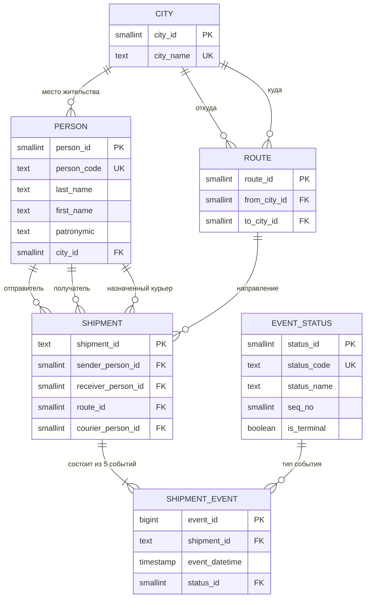
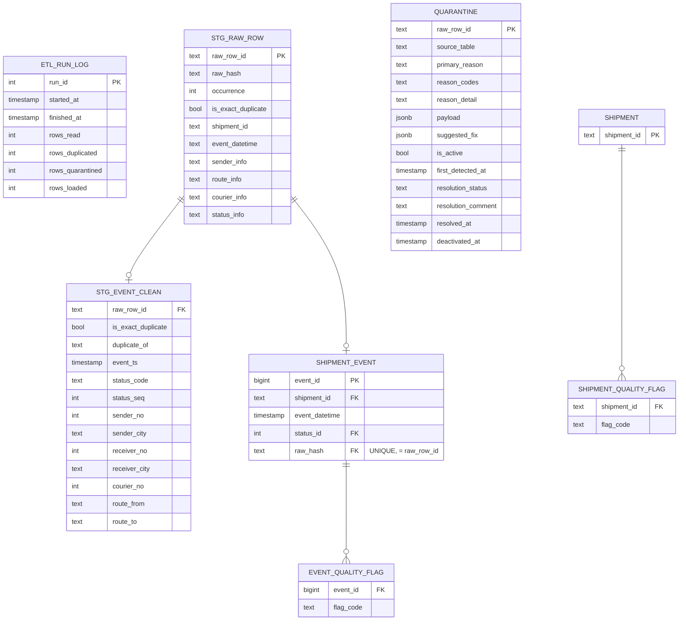
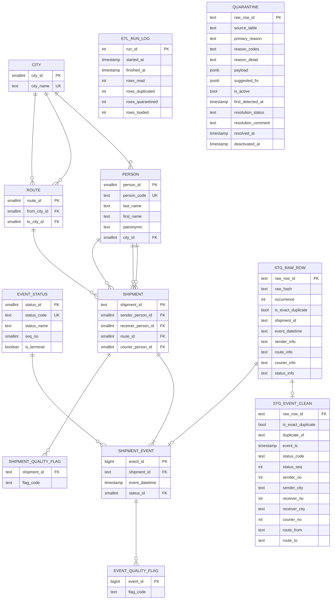
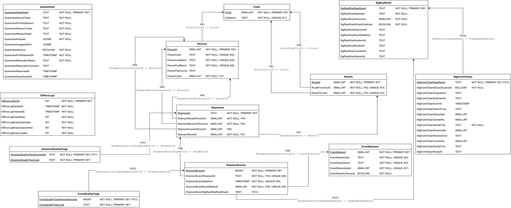

# Физическая модель и DLL

Данный документ, поскольку этапы 3 и 4 являются по сути сильносвязными продолжениями друг друга, реализует сразу две поставленные задачи:

* разработка физической модели (или, по другому, целевая ER-диаграмма данных): "*После обследования отрисовать целевую ER-схему хранилища в pgModeler либо другом ER-инструменте. Схема должна отражать таблицы, ключи и связи.*";
* разработка SQL DDL: "*Реализовать целевую модель в схеме core. Составные RAW-поля разобрать; повторяющиеся сущности выделить.*".

## Физическая модель

На основе представленных анализов сырых данных [здесь](./01_профилирование.md) и [здесь](./02_модель_и_правила.md), где уже есть полноценное описание модели "сущность-связь" (она же: логическая ER-диаграмма), предлагается следующая полноценная физическая модель.

Для начала, чтобы вспомнить, логическая модель данных из анализа:

Также нам понадобится набор некоторых служебных таблиц из тех же документов с анализом:

* `stg_raw_row` — снимок RAW: одна строка = одна строка `public.raw_data_06` со стабильным `raw_row_id` (хеш 7 полей + номер повтора);
* `stg_event_clean` — разобранные и стандартизованные поля каждой строки RAW, причины карантина и флаги качества;
* `quarantine` — очередь карантина: исходная строка (`payload`), причины, статус ручной обработки;
* `raw_row_outcome` — итог каждой строки RAW: LOAD / QUARANTINE / DUPLICATE;
* `etl_run_log` — журнал запусков pipeline (создаётся в `sql/08_quality_control.sql`);
* `event_quality_flag` — флаги качества событий;
* `shipment_quality_flag` — флаги качества посылок.

`shipment_event.raw_hash` хранит `raw_row_id` строки RAW (FK14 → `stg_raw_row.raw_row_id`) и уникален (K9):
одна строка RAW даёт не больше одного события, точные дубли событий не создают.

Итого, общая таблица модели сущности-связи, объединяя два предыдущих:

Преобразования доменов:

* для основных идентификаторов было принято использовать стандартный тип `INT`;
* для таблицы с городами (**CITY** -> **Cities**) выбран стандартный тип `SMALLINT`, из-за размерностей и реального количества городов;
* для тех мест, где можно было бы выбрать стандартный тип `TINYINT` был выбран `SMALLINT`, из-за того, что некоторые реализации БД *не поддерживают* `TINYINT`.

Соответствующая физическая модель:

Некоторые примечания к "прочтению" диаграммы:

1. все атрибуты по умолчанию имеют свойство *необязательный*;
2. номера внешних ключей "глобальны" для удобства;
3. свойство `UNIQUE (Kn)` для атрибутов, где *`n`* одинаково, означает связку или составной, *не основной* (не `PRIMARY KEY`) ключ.

## SQL DDL

Вторая часть предполагает описание полученной [целевой модели](#физическая-модель) в схеме `core`. Поскольку физическая модель построена на модели сущности-связи, для которой были решены проблемы с составными полями и повторяющимися сущностями (приведена к 2-ой или 3-ей нормальной форме, если более формально), то задача это части сводится к простому написанию SQL кода, который бы создавал необходимые таблицы и связи.

Набор SQL запросов для создания основных таблиц (по запросу коллег все названия, в отличие от физической модели выше приведены к `snake_case` и к названиям из модели сущности-связи) описан в файле [`Task3.sql`](./Task3.sql).
