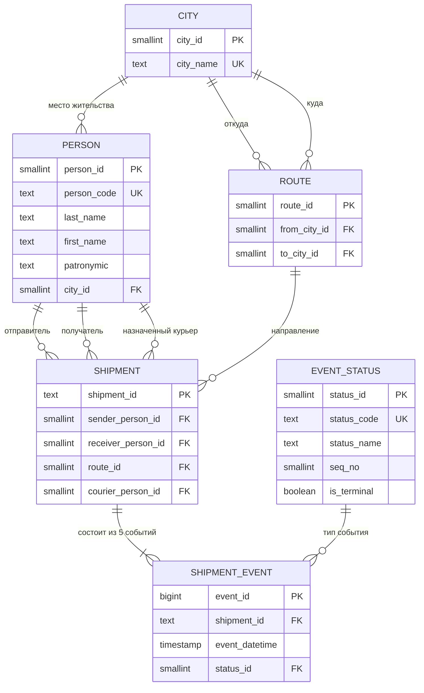
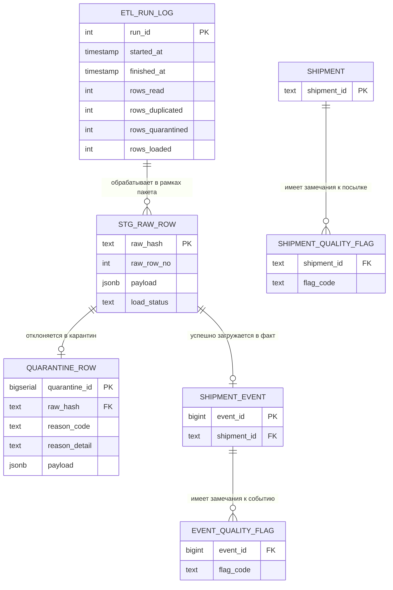
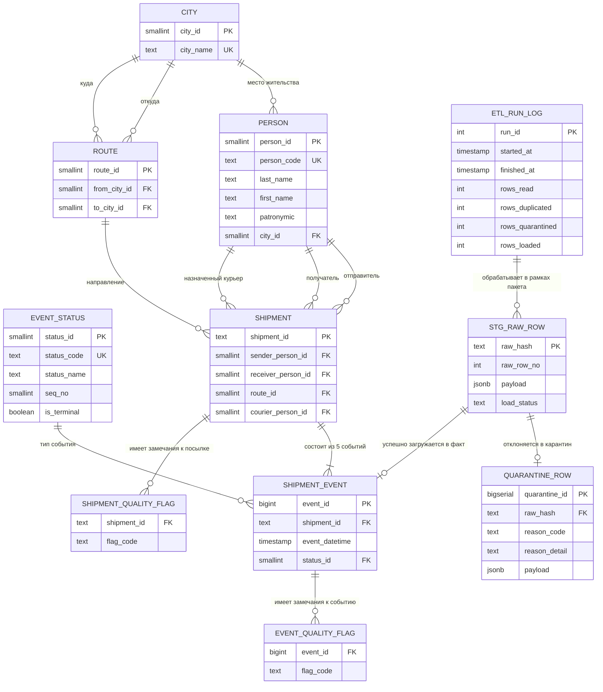

# Физическая модель и DLL

Данный документ, поскольку этапы 3 и 4 являются по сути сильносвязными продолжениями друг друга, реализует сразу две поставленные задачи:

* разработка физической модели (или, по другому, целевая ER-диаграмма данных): "*После обследования отрисовать целевую ER-схему хранилища в pgModeler либо другом ER-инструменте. Схема должна отражать таблицы, ключи и связи.*";
* разработка SQL DDL: "*Реализовать целевую модель в схеме core. Составные RAW-поля разобрать; повторяющиеся сущности выделить.*".

## Физическая модель

На основе представленных анализов сырых данных [здесь](./01_профилирование.md) и [здесь](./02_модель_и_правила.md), где уже есть полноценное описание модели "сущность-связь" (она же: логическая ER-диаграмма), предлагается следующая полноценная физическая модель.

Для начала, чтобы вспомнить, логическая модель данных из анализа:

Также нам понадобится набор некоторых служебных таблиц из тех же документов с анализом:

* `stg_raw_row` - журнал прибытия, куда будут записываться статусы для прибывающих и пребывающих товаров;
* `quarantine_row` - изоляция для товаров;
* `etl_run_log` - отчёт.

Введём ещё две служебные таблицы `event_quality_flag` и `shipment_quality_flag` флаги качества для событий и обозначений аномалий. Для таких данных модель сущность-связь будет выглядеть так:

Итого, общая таблица модели сущности-связи, объединяя два предыдущих:

Преобразования доменов:

* для основных идентификаторов было принято использовать стандартный тип `INT`;
* для таблицы с городами (**CITY** -> **Cities**) выбран стандартный тип `SMALLINT`, из-за размерностей и реального количества городов;
* для некоторых идентификаторов-кодов был выбран тип `CHAR(...)`, который устанавливает статический размер строки в БД, - здесь следует смотреть на [п. 4 анализа](./02_модель_и_правила.md#4-словарь-данных-атрибуты-типы-ключи-ограничения);
* для тех мест, где можно было бы выбрать стандартный тип `TINYINT` был выбран `SMALLINT`, из-за того, что некоторые реализации БД *не поддерживают* `TINYINT`.

Соответствующая физическая модель:

Некоторые примечания к "прочтению" диаграммы:

1. все атрибуты по умолчанию имеют свойство *необязательный*;
2. номера внешних ключей "глобальны" для удобства;
3. свойство `UNIQUE (Kn)` для атрибутов, где *`n`* одинаково, означает связку или составной, *не основной* (не `PRIMARY KEY`) ключ.

## SQL DDL

Вторая часть предполагает описание полученной [целевой модели](#физическая-модель) в схеме `core`. Поскольку физическая модель построена на модели сущности-связи, для которой были решены проблемы с составными полями и повторяющимися сущностями (приведена к 2-ой или 3-ей нормальной форме, если более формально), то задача это части сводится к простому написанию SQL кода, который бы создавал необходимые таблицы и связи.

Набор SQL запросов для создания основных таблиц (по запросу коллег все названия, в отличие от физической модели выше приведены к `snake_case` и к названиям из модели сущности-связи) описан в файле [`Task3.sql`](./Task3.sql).
