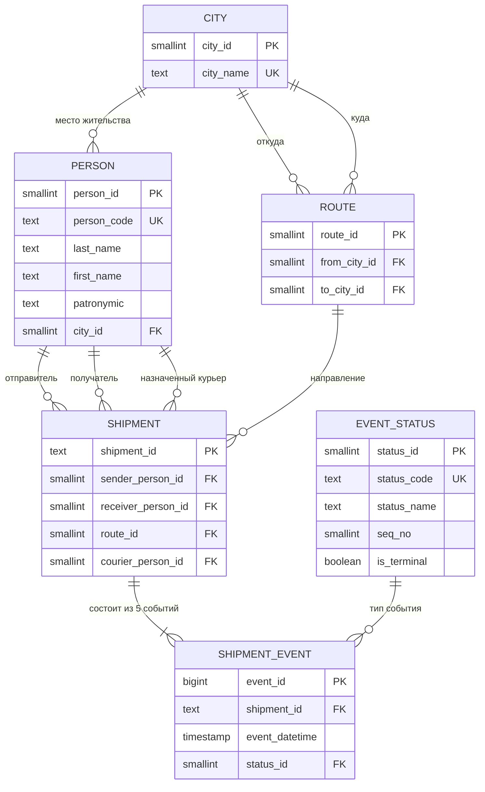
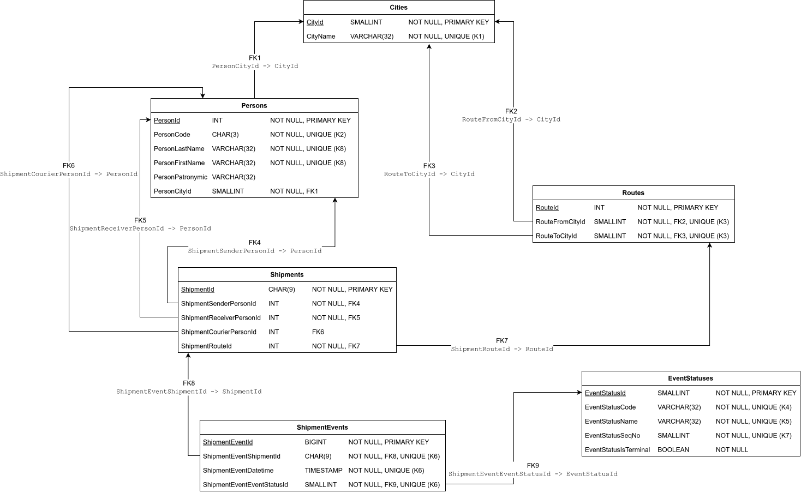

# Физическая модель и DLL

Данный документ, поскольку этапы 3 и 4 являются по сути сильносвязными продолжениями друг друга, реализует сразу две поставленные задачи:

* разработка физической модели (или, по другому, целевая ER-диаграмма данных): "*После обследования отрисовать целевую ER-схему хранилища в pgModeler либо другом ER-инструменте. Схема должна отражать таблицы, ключи и связи.*";
* разработка SQL DDL: "*Реализовать целевую модель в схеме core. Составные RAW-поля разобрать; повторяющиеся сущности выделить.*".

## Физическая модель

На основе представленных анализов сырых данных [здесь](./01_профилирование.md) и [здесь](./02_модель_и_правила.md), где уже есть полноценное описание модели "сущность-связь" (она же: логическая ER-диаграмма), предлагается следующая полноценная физическая модель.

Для начала, чтобы вспомнить, логическая модель данных из анализа:



Преобразования доменов:

* для основных идентификаторов было принято использовать стандартный тип `INT`;
* для таблицы с городами (**CITY** -> **Cities**) выбран стандартный тип `SMALLINT`, из-за размерностей и реального количества городов;
* для некоторых идентификаторов-кодов был выбран тип `CHAR(...)`, который устанавливает статический размер строки в БД, - здесь следует смотреть на [п. 4 анализа](./02_модель_и_правила.md#4-словарь-данных-атрибуты-типы-ключи-ограничения);
* для тех мест, где можно было бы выбрать стандартный тип `TINYINT` был выбран `SMALLINT`, из-за того, что некоторые реализации БД *не поддерживают* `TINYINT`.

Соответствующая физическая модель:



Некоторые примечания к "прочтению" диаграммы:

1. все атрибуты по умолчанию имеют свойство *необязательный*;
2. номера внешних ключей "глобальны" для удобства;
3. свойство `UNIQUE (Kn)` для атрибутов, где *`n`* одинаково, означает связку или составной, *не основной* (не `PRIMARY KEY`) ключ.

## SQL DDL

Вторая часть предполагает описание полученной [целевой модели](#физическая-модель) в схеме `core`. Поскольку физическая модель построена на модели сущности-связи, для которой были решены проблемы с составными полями и повторяющимися сущностями (приведена к 2-ой или 3-ей нормальной форме, если более формально), то задача это части сводится к простому написанию SQL кода, который бы создавал необходимые таблицы и связи.

```sql
-- Схема 'core'.
CREATE SCHEMA IF NOT EXISTS core;

-- Таблица 'Cities' в схеме 'core'.
CREATE TABLE core.Cities (
    CityId SMALLINT PRIMARY KEY NOT NULL,
    CityName VARCHAR(32) NOT NULL UNIQUE -- UNIQUE (K1)
);

-- Таблица 'EventStatuses' в схеме 'core'.
CREATE TABLE core.EventStatuses (
    EventStatusId SMALLINT PRIMARY KEY NOT NULL,
    EventStatusCode VARCHAR(32) NOT NULL UNIQUE, -- UNIQUE (K4)
    EventStatusName VARCHAR(32) NOT NULL UNIQUE, -- UNIQUE (K5)
    EventStatusSeqNo SMALLINT NOT NULL UNIQUE, -- UNIQUE (K7)
    EventStatusIsTerminal BOOLEAN NOT NULL
);

-- Таблица 'Persons' в схеме 'core'.
CREATE TABLE core.Persons (
    PersonId INT PRIMARY KEY NOT NULL,
    PersonCode CHAR(3) NOT NULL UNIQUE, -- UNIQUE (K2)
    PersonLastName VARCHAR(32) NOT NULL,
    PersonFirstName VARCHAR(32) NOT NULL,
    PersonPatronymic VARCHAR(32),
    PersonCityId SMALLINT NOT NULL,
    CONSTRAINT Persons_K1 UNIQUE (PersonLastName, PersonFirstName), -- UNIQUE (K8)
    CONSTRAINT Persons_FK1 FOREIGN KEY (PersonCityId) REFERENCES core.Cities (CityId) -- FK1
);

-- Таблица 'Routes' в схеме 'core'.
CREATE TABLE core.Routes (
    RouteId INT PRIMARY KEY NOT NULL,
    RouteFromCityId SMALLINT NOT NULL,
    RouteToCityId SMALLINT NOT NULL,
    CONSTRAINT Routes_K1 UNIQUE (RouteFromCityId, RouteToCityId), -- UNIQUE (K3)
    CONSTRAINT Routes_FK1 FOREIGN KEY (RouteFromCityId) REFERENCES core.Cities (CityId), -- FK2
    CONSTRAINT Routes_FK2 FOREIGN KEY (RouteToCityId) REFERENCES core.Cities (CityId) -- FK3
);

-- Таблица 'Shipments' в схеме 'core'.
CREATE TABLE core.Shipments (
    ShipmentId CHAR(9) PRIMARY KEY NOT NULL,
    ShipmentSenderPersonId INT NOT NULL,
    ShipmentReceiverPersonId INT NOT NULL,
    ShipmentCourierPersonId INT,
    ShipmentRouteId INT NOT NULL,
    CONSTRAINT Shipments_FK1 FOREIGN KEY (ShipmentSenderPersonId) REFERENCES core.Persons (PersonId), -- FK4
    CONSTRAINT Shipments_FK2 FOREIGN KEY (ShipmentReceiverPersonId) REFERENCES core.Persons (PersonId), -- FK5
    CONSTRAINT Shipments_FK3 FOREIGN KEY (ShipmentCourierPersonId) REFERENCES core.Persons (PersonId), -- FK6
    CONSTRAINT Shipments_FK4 FOREIGN KEY (ShipmentRouteId) REFERENCES core.Routes (RouteId) -- FK7
);

-- Таблица 'ShipmentEvents' в схеме 'core'.
CREATE TABLE core.ShipmentEvents (
    ShipmentEventId BIGINT PRIMARY KEY NOT NULL,
    ShipmentEventShipmentId CHAR(9) NOT NULL,
    ShipmentEventDatetime TIMESTAMP NOT NULL,
    ShipmentEventEventStatusId SMALLINT NOT NULL,
    CONSTRAINT ShipmentEvents_K1 UNIQUE (ShipmentEventShipmentId, ShipmentEventDatetime, ShipmentEventEventStatusId), -- UNIQUE (K6)
    CONSTRAINT ShipmentEvents_FK1 FOREIGN KEY (ShipmentEventShipmentId) REFERENCES core.Shipments (ShipmentId), -- FK8
    CONSTRAINT ShipmentEvents_FK2 FOREIGN KEY (ShipmentEventEventStatusId) REFERENCES core.EventStatuses (EventStatusId) -- FK9
);
```
